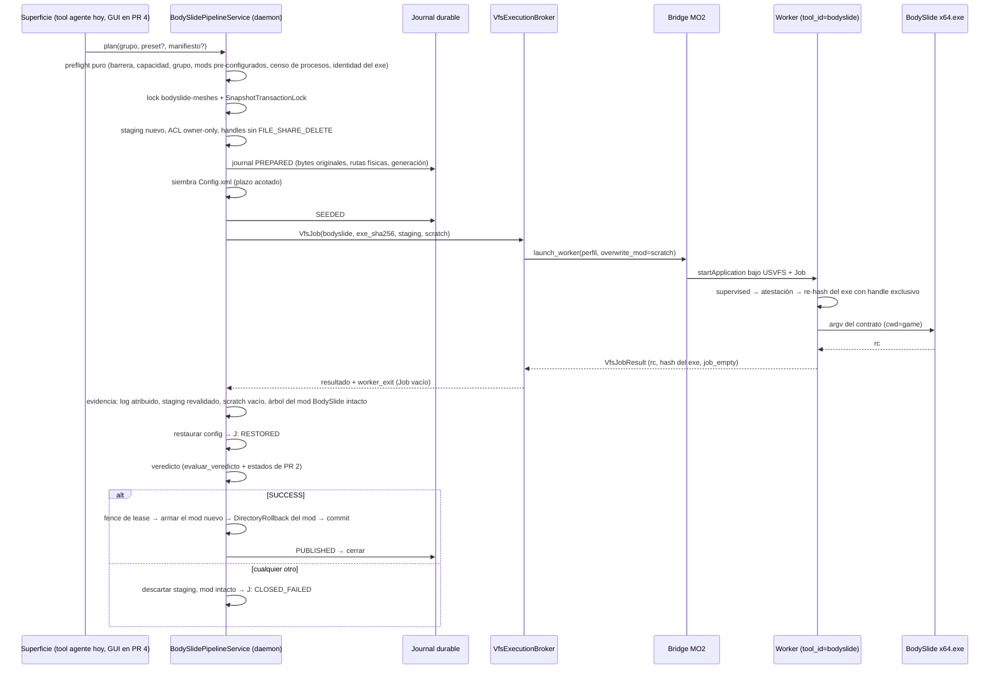

# BodySlide PR 2 — Broker USVFS y ejecución transaccional (concepts brief)

**Fecha:** 2026-11-23 · **Base auditada:** `origin/main` `3629013047ce676c1fd60d15d7102d0246799264` (squash de #1003)
**Estado:** `DESIGN_APPROVED_WITH_CHANGES / IMPLEMENTATION_PR2A_ONLY` (dictamen del propietario, 2026-11-23).
Las resoluciones P-1 a P-6 y los ajustes obligatorios C1 a C5 están en §13 y **prevalecen** sobre el texto
original de §4–§11 donde lo contradigan. Solo PR 2a está autorizado (§13.3).
**Alcance:** PR 2 (ejecución brokered bajo MO2/USVFS, recuperación transaccional, publicación al perfil MO2).
Fuera de alcance: catálogo y `preset_verified` en la tool (PR 3), GUI (PR 4), activación productiva.

---

## 0. Resumen ejecutivo

1. **`main` está sano.** `36290130` tiene `Sky-Claw CI/CD`, `Push on main` y `Main en verde` en `success`. No hay bloqueos de CI que heredar.
2. **No hace falta un broker nuevo.** `VfsExecutionBroker` + bridge MO2 + `vfs_worker` (ADR 0007) ya cubren el perfil explícito, el Job Object `KILL_ON_JOB_CLOSE`, el fence `supervised`, `worker_exit` solo con el Job vacío, la cuarentena persistente y el veto de rollback. PR 2 agrega **un `tool_id` nuevo (`bodyslide`)** y una estrategia brokered con la misma forma que `brokered_synthesis.py`.
3. **La salida deja de vivir en `<game>/BodySlide_Output/<grupo>`.** BodySlide escribe en un **staging físico fuera del VFS y fuera de `mods/`**. Al final se publica de forma transaccional a **un mod de salida preconfigurado y habilitado** (`DirectoryRollback`, el mismo patrón que el empaquetado de DynDOLOD). Nunca se escribe en `Data` ni en la carpeta de otro mod.
4. **Restaurar la config sobrevive a un crash.** Un journal durable en `SystemPaths.runtime_state_dir()` se escribe antes de la siembra. El reconciliador de arranque lo consume, pero solo con **terminalidad demostrada**.
5. **Producción sigue apagada.** PR 2 entra dormido detrás de una barrera `_CONTENCION_BODYSLIDE_VERIFICADA = False`, igual que Synthesis. Aunque se levantara, la tool del agente sigue sin `preset_verified` hasta PR 3, así que su techo es `EVIDENCE_INCOMPLETE`. Ningún camino puede dar SUCCESS por haber conseguido lanzar el binario.
6. **Propuesta de corte:** cuatro PRs chicos (2a–2d, §9) en vez de uno. El presupuesto de la política de cierre (1 revisión adversarial + 1 ronda) no alcanza para un PR de ~3000 líneas sobre tres subsistemas.

---

## 1. Verificación previa (Fase A.1–A.2)

| Ítem | Resultado | Evidencia |
|---|---|---|
| `origin/main` | `36290130` (un solo padre `f3badb2a`) | `git log origin/main` |
| CI post-merge #1003 | 🟢 los tres workflows `success` | `gh run list --branch main` (2026-11-23 20:43–20:59Z) |
| Normas leídas | `AGENTS.md`, `docs/agents/completion_policy.md`, R1–R15 (`merge_and_conflict_resolution.md`) | — |
| ADR aplicables | **0007** (broker USVFS), **0017** (gate de exclusión MO2), **0019** (Synthesis en dos fases: patrón de salida administrada, entorno curado, `USERNAME`), **0011** (work root externo: propiedades de lock y base durable), **0012** (Frozen Runtime: censo de superficies) | `docs/adr/` |
| Diferidos de PR 1 | Tomados de `docs/validation/2026-11-22_bodyslide-pr1-audit-corrections.md` §«Estado vigente» y §«Diferido explícitamente» | — |

---

## 2. Inventario: qué existe y qué se reutiliza

### 2.1 BodySlide (mergeado en #1003)

| Componente | Archivo | Qué garantiza hoy | Uso en PR 2 |
|---|---|---|---|
| Contrato puro | `local/tools/bodyslide_headless.py` | argv cerrado (`-gbuild -t [-p] [-tri] [-q]`), identidad Win32 del grupo, destino canónico, `evaluar_veredicto` (nunca SUCCESS sin preset verificado), `ManifiestoArtefactos`, marcadores del log | **Se reutiliza tal cual.** Se suman estados terminales nuevos (§6.4) |
| Runner | `local/tools/bodyslide_runner.py` | snapshot → siembra → `run_capture(require_job=True)` → atribución del log → restore atómico con `mutar_hasta_terminal` | **Se parte en dos:** la parte pura (snapshot, siembra, atribución, veredicto) la consume el servicio. El spawn directo queda como backend `standalone`, también dormido |
| Siembra | `local/tools/bodyslide_config.py` | Config.xml leído como lo lee BodySlide, sin enlaces, `TargetGame` validado | Se reutiliza. Opera sobre el **archivo físico ganador** (§4.2) |
| Tool del agente | `app/agent/tools/system_tools.py::run_bodyslide_batch` | lock `bodyslide-meshes` + `SnapshotTransactionLock` + `DirectoryRollback` del target + veto `lease_lost` | Pasa a delegar en el servicio (§3). Es **la única superficie viva**: no hay ruta GUI ni dispatcher para BodySlide |
| Raíz de salida | `output_targets.bodyslide_output_root/target` | `<game>/BodySlide_Output/<grupo>` | **Cambia** en modo brokered (D2). La ruta legacy queda para el reconciliador |
| Reconciliador | `rollback_reconciler.py` (`"bodyslide"` en `PRODUCTORES_CABLEADOS`, `_destinos_bodyslide_por_escaneo`) | restaura `.rollback-<nonce>` huérfanos del staging | Se amplía con dos productores: el mod de salida (con `destinos_nunca_vacios`) y el journal de config |

### 2.2 Infraestructura USVFS (ADR 0007, reutilizable sin cambios de protocolo)

| Pieza | Archivo | Qué aporta |
|---|---|---|
| Broker | `local/mo2/vfs_broker.py` | `submit(job, overwrite_mod=…)`, fence `supervised`, deadline de 90 s con el bridge conectado, `post_result_cancel_grace`, `VfsBridgeLostTeardownError`, nunca `set_result(None)` |
| Contratos | `local/mo2/vfs_contracts.py` | `ALLOWED_VFS_TOOL_IDS` (literal), `VfsJob`/`VfsJobResult` firmados con HMAC |
| Worker | `local/mo2/vfs_worker.py` | handlers por `tool_id` con payload cerrado. Plantilla directa: `_synthesis_handler` (exe real, no symlink, nombre permitido) |
| Bridge | `plugin_bundle/skyclaw_bridge/runtime.py` | `startApplication(…, overwrite_mod)`: el **quinto argumento es el nombre de un mod de overwrite forzado** (ADR 0007 §HITL: «una tool futura que necesite salida dedicada deberá enviar el nombre validado de un mod administrado») |
| Atestación | `vfs_attestation.py`, `vfs_job_identity.py` | fingerprint v2 del perfil, canary y prueba del nieto |
| Cuarentena | `vfs_quarantine.py` + modo `vfs-quarantine` | marcador persistente; se libera solo con un `worker_exit` tardío o con evidencia del operador |
| Veto | `app/db/rollback_veto.py::exception_forbids_rollback` | `SnapshotTransactionLock` y `DirectoryRollback` no restauran con terminalidad desconocida |
| Estrategias hermanas | `brokered_loot.py`, `brokered_dyndolod.py`, `brokered_synthesis.py` | patrón `resolve_*_backend` + guard `VfsRequired*` + barrera `_CONTENCION_*_VERIFICADA` |

### 2.3 Primitivas de disco y seguridad

`DirectoryRollback` y `mutar_hasta_terminal` (`_dir_rollback.py`), `_recrear_mod_de_salida_vacio` y `_package_output_as_mod` (DynDOLOD: copia completa + presupuesto de coexistencia + `finalization_completed`), `link_kind_or_raise`, `exigir_contencion_fisica`, `rmtree_link_aware` (`app/security/links.py`), `restrict_to_owner` (`file_permissions.py`), `indexar_ganadores` (`local/mo2/ganadores.py`: ganador físico por ruta según el perfil), `OperationJournal` (`app/db/journal.py`), `SystemPaths.runtime_state_dir()`.

**Conclusión:** la única abstracción nueva que se justifica es un **`BodySlidePipelineService`**. El motivo es la regla de los hermanos: PR 4 agrega la superficie GUI, y las dos superficies tienen que compartir un solo lock, journal, preflight y veredicto. Es el mismo patrón que `DynDOLODPipelineService`, `SynthesisPipelineService` y `ejecutar_fase_asistida` de Wrye Bash. Las demás piezas de PR 2 se ensamblan con lo que ya existe.

---

## 3. Flujo completo propuesto

**Orden invariante:** journal antes de la primera mutación; restaurar la config antes de publicar; publicar solo con SUCCESS, lease vigente y terminalidad confirmada.

---

## 4. Decisiones de diseño

### D1 — Reutilizar el broker existente con `tool_id="bodyslide"` (no uno nuevo)

- **Alternativas:** (a) un broker propio para BodySlide, (b) `moshortcut://`, (c) `run_capture` directo como hoy.
- **Se descarta** (a) porque duplica la cuarentena, el fence y el teardown que costaron F1, #980, #987 y #993. Se descarta (b) por ADR 0007: no tiene contrato de ciclo de vida. Y (c) no ve el VFS: con slider sets repartidos en mods, BodySlide vería solo el `Data` físico y daría un falso verde.
- **Qué cambia:** `ALLOWED_VFS_TOOL_IDS` suma `"bodyslide"` (no es de sesión: un solo job). Se agrega `_bodyslide_handler` con payload cerrado: `bodyslide_exe` (ruta virtual), `exe_sha256`, `argv_contract` (grupo, target, preset y flags, revalidados con `construir_argv` en el worker) y `staging_root`. El worker **no siembra ni restaura**: el dueño de snapshots y journal es el daemon (ADR 0007 §HITL y rollback).
- **Un Job Object no sustituye al protocolo.** El Job contiene el árbol, pero solo el broker distingue resultado aceptado, `worker_exit` con Job vacío y terminalidad desconocida. El veredicto exige las tres cosas.

### D2 — Staging físico fuera del VFS y fuera de `mods/`

- **Ubicación:** `<base MO2>/.skyclaw/bodyslide/<run_id>/out`, hermano de `mods/` y no hijo. Está en el mismo volumen que `mods/`, para que el rename de publicación sea O(1) y atómico. Si los volúmenes difieren se usa copia con presupuesto de coexistencia, el patrón de DynDOLOD.
- **Por qué no dentro de `mods/`:** MO2 agrega toda carpeta nueva de `mods/` al modlist del perfil que cargue (incidente documentado en el rig).
- **Por qué no `-t` dentro del `Data` virtual:** con USVFS, escribir sobre un archivo que ya existe en otro mod lo **modifica en su carpeta física**. Si otro mod trae `meshes/actors/character/character assets/femalebody_1.nif`, BodySlide lo pisaría en el mod ajeno. Eso viola la restricción de no sobrescribir archivos de otros mods, así que se descarta.
- **Alternativa evaluada:** el `external_work_root` de ADR 0011. Su binding y su máquina de estados son específicos de DynDOLOD, y extenderlos acopla dos etapas. Queda como opción del propietario (P-2).

### D3 — Overwrite forzado a un mod *scratch* exclusivo

`startApplication` recibe `overwrite_mod="Sky-Claw BodySlide Scratch"`. Es un mod preconfigurado, vacío y deshabilitado o habilitado al final. Todo archivo **nuevo** que BodySlide cree en el VFS cae ahí y no en el overwrite global, que comparten otras herramientas. Después de la corrida, el scratch tiene que estar vacío, o contener solo entradas permitidas (`Log_BS.txt` si no existía antes). Cualquier malla ahí significa `WRITE_OUTSIDE_STAGING`, nunca SUCCESS, y se limpia con `rmtree_link_aware`. *Verificar en el rig si MO2 exige que el mod forzado exista y si tiene que estar habilitado (R-3).*

### D4 — Siembra y restauración en el daemon, sobre el archivo físico ganador

`Config.xml`, `BodySlide.xml`, `BuildSelection.xml` y `Log_BS.txt` viven en la carpeta del mod de BodySlide. Bajo USVFS, BodySlide los muta **en ese mod**: es inherente a la herramienta. Para dejar ese mod byte a byte igual:

- `indexar_ganadores` resuelve la ruta física ganadora de cada archivo. Se rechaza si un archivo lo aportan dos mods con contenido distinto en una posición ambigua, o si es un enlace.
- El snapshot incluye además un **hash de árbol** del mod de BodySlide. Después de la corrida, el árbol tiene que coincidir con el snapshot salvo los cuatro archivos, que se restauran byte a byte. `Log_BS.txt` se copia antes a la evidencia de la corrida.
- Restaurar exige terminalidad confirmada (`worker_exit`). Con `terminality_unknown` el veto impide restaurar, el journal queda `PENDING_TERMINALITY` y el resultado es `HOLD`.

### D5 — Journal durable de la config (cierra el «restore best-effort» de PR 1)

- **Archivo:** `runtime_state_dir()/bodyslide_journal/<instance_id>.json`. Escritura atómica (temporal + `os.replace` + `fsync` del archivo y del directorio), ACL owner-only, schema v1 cerrado (un campo de más significa corrupto y fail-closed, como el binding de ADR 0011).
- **Contenido:** `run_id`, `generacion` (128 bits), `boot_id` de la máquina, `pid` y hora de inicio del daemon, `instance_id`, rutas físicas, hashes y bytes originales en base64 (son archivos chicos), estado `PREPARED → SEEDED → LAUNCHED → TERMINAL → RESTORED → (PUBLISHING → PUBLISHED | CLOSED_FAILED)`, y el `run_id` del staging.
- **Base durable, no relativa al cwd:** misma lección que ADR 0011 (`locks.db` relativo al cwd no excluye a dos procesos).
- **Consumo:** un productor nuevo del reconciliador, `bodyslide-config`, corre bajo el lock del recurso y restaura **solo** si se cumple al menos una condición:
  1. el journal está en `TERMINAL` o en un estado posterior;
  2. el `boot_id` cambió, porque un reinicio prueba que ningún proceso de la corrida sigue vivo (P-4 decide si se acepta como evidencia);
  3. la instancia tuvo un `worker_exit` tardío;
  4. el operador liberó la cuarentena con evidencia.

  En cualquier otro caso hay cuarentena y no se restaura.
- **Restauración condicional:** se restaura solo si el archivo actual es igual a los bytes **sembrados** registrados. Si tiene un tercer contenido, alguien más lo escribió: `CONCURRENT_MODIFICATION`, no se pisa y se preserva la evidencia.

### D6 — Espera acotada de la siembra (cierra el pendiente de `_BarreraDeSiembra`)

La siembra y la restauración corren con un plazo (`bodyslide_config_io_timeout_seconds`, 30 s). Un hilo de Python no se puede matar. Si vence el plazo:

- el resultado es `CONFIG_IO_HUNG` y nunca se lanza;
- el journal queda en `SEEDED?` (indeterminado);
- el recurso `bodyslide-meshes` entra en **cuarentena persistente**, con el mismo vocabulario que `vfs_quarantine`;
- el lock no se libera hasta que el hilo termine o el operador libere con evidencia.

Así el dueño siguiente no recibe una escritura tardía. La propiedad que lo resume: *nunca se libera un recurso con una mutación en vuelo*, la misma de `mutar_hasta_terminal`, ahora con salida acotada para el caller.

### D7 — Identidad y capacidad del ejecutable (cierra `quiet_verified` declarativo)

- `quiet_verified` deja de ser un booleano de config y se **deriva** de un registro cerrado de binarios atestiguados (`BODYSLIDE_BINARIOS_ATESTIGUADOS`: SHA-256 y versión de `VERSIONINFO`). Cada entrada viene de evidencia del rig y la congela un test por igualdad literal. Un hash desconocido da `CAPABILITY_UNKNOWN` sin spawn.
- **Preview:** hash del ganador físico (`indexar_ganadores`), que tiene que ser archivo regular, sin enlace y con `nlink == 1`.
- **Worker:** abre el exe virtual con `share=FILE_SHARE_READ`, sin `WRITE` ni `DELETE`, y lo re-hashea. El hash tiene que coincidir con `exe_sha256` del job. Mantiene el handle hasta que `CreateProcess` termina. Eso cierra la ventana TOCTOU entre el hash y la ejecución (lección F-02 de Synthesis).
- **Alternativa descartada:** validar solo por versión. Un binario parcheado conserva su `VERSIONINFO`.

### D8 — Concurrencia externa (BodySlide/Outfit Studio abiertos)

- **Antes del spawn:** censo de procesos cuya imagen tenga la **misma identidad física** (volumen + file ID) que el exe de BodySlide u Outfit Studio del perfil, o cualquier `BodySlide*.exe` u `OutfitStudio*.exe`. Si encuentra alguno: `PRECONDITION_FAILED`, sin siembra.
- **Durante la corrida:** no se puede excluir `Config.xml` con `FILE_SHARE_NONE` porque BodySlide tiene que leerlo. El ADR 0017 §3 muestra además que la exclusión impide el reemplazo atómico. Por eso la detección es **posterior**: censo de procesos repetido, `Config.xml` igual a los bytes sembrados y `BuildSelection.xml` igual a su snapshot. Cualquier diferencia da `CONCURRENT_MODIFICATION` y nunca SUCCESS.
- **Residual declarado:** una instancia externa que lea la config sembrada y salga sin escribir no se detecta. No produce salida en el staging (es exclusivo), así que no puede contaminar el veredicto.

### D9 — TOCTOU staging ↔ spawn

- El staging es nuevo y propio de la corrida (`mkdir` sin `exist_ok`), con ACL owner-only.
- Mientras dura la corrida, el daemon **mantiene abiertos** handles de la raíz del staging y de cada ancestro hasta `.skyclaw/`, con `FILE_SHARE_READ|WRITE` y sin `FILE_SHARE_DELETE`. Mientras existan esos handles, nadie puede renombrarlos ni reemplazarlos por un junction.
- **Después de la corrida:** recorrido con `lstat`. Se rechaza cualquier enlace o reparse point, hardlink (`nlink > 1`), ADS en los artefactos, archivo fuera de `{.nif, .tri}` o ruta fuera del confinamiento. La identidad `(st_dev, st_ino)` de la raíz tiene que ser la misma que antes del spawn.
- Esto reemplaza el «staging con archivos previos» diferido (hilo 4670337600): el staging nace vacío por construcción y el guard vive en el servicio común, así que cubre a todo caller.

### D10 — Publicación a un mod de salida preconfigurado

- **Precondiciones, sin mutar el perfil:** el mod `Sky-Claw BodySlide Output` (P-1) existe en `mods/`, es carpeta real, está **habilitado** en `modlist.txt` del perfil y contiene solo archivos de propiedad de Sky-Claw más `meta.ini`. La propiedad sale del manifiesto `.skyclaw/bodyslide_ownership.json` dentro del mod. Un archivo ajeno da `OUTPUT_MOD_NOT_OWNED` y no se publica. Sky-Claw **no** edita `modlist.txt` ni `plugins.txt`: la activación desatendida queda fuera, como en ADR 0019 §2.3, que la difiere hasta certificar quiescencia.
- **Armado:** en `.skyclaw/bodyslide/<run_id>/mod_nuevo/` se arma el mod completo: archivos de los **otros** grupos copiados del mod vigente según el manifiesto, archivos nuevos del grupo, `meta.ini` preservado y manifiesto actualizado. Si un archivo del grupo choca con uno de otro grupo: `CONFLICT_BETWEEN_GROUPS`, HOLD (resolverlo es PR 3).
- **Commit:** fence de lease (`not tx.lease_lost`), después `DirectoryRollback(mod)` (move-aside O(1)), después `os.replace(mod_nuevo, mod)`, y por último verificación del árbol publicado contra el manifiesto (hash por archivo). Solo con `finalization_completed=True` se emite `PUBLISHED`. Cualquier fallo restaura el mod previo byte a byte.
- **Muerte dura durante la publicación:** el residuo `<mod>.rollback-<nonce>` lo enumera el productor del reconciliador para el mod, con `destinos_nunca_vacios`: un mod habilitado nunca queda sin carpeta (lección de #993).
- **Informe de conflictos MO2 (solo lectura):** con `indexar_ganadores` se listan los archivos publicados que **otro mod de mayor prioridad** tapa. No es un fallo de publicación, pero se informa como `published_shadowed` y bloquea SUCCESS si el manifiesto los declara obligatorios.

---

## 5. Recuperación ante fallos

| Evento | Detección | Proceso | Config BodySlide | Staging / mod | Estado final |
|---|---|---|---|---|---|
| Timeout | plazo del servicio | `cancel` → el bridge cierra el Job → `worker_exit` | restaurada (terminal) | staging descartado; mod intacto | `TIMEOUT` |
| Cancelación (agente/GUI) | `CancelledError` | ídem, con `mutar_hasta_terminal` retenido hasta restaurar | restaurada | ídem | `CANCELLED` |
| MO2 se cierra | bridge perdido > `fence_grace` (30 s) | `VfsBridgeLostTeardownError` → cuarentena de instancia | **no** se restaura (veto); journal `PENDING_TERMINALITY` | sin publicación; staging preservado como evidencia | `HOLD_TERMINALITY_UNKNOWN` |
| Pérdida de lease | `tx.lease_lost` | Job cancelado | se restaura solo si es terminal y el archivo está igual a lo sembrado | sin publicación; `should_rollback` vetado | `HOLD_LEASE_LOST` |
| Crash duro del daemon | journal ≠ cerrado al arrancar | **sigue vivo bajo MO2**: el Job es del bridge, no del daemon | el reconciliador espera evidencia (D5 1–4); sin ella, cuarentena | staging y `.rollback-*` los reconcilia el productor | `HOLD` hasta tener evidencia, después `RECOVERED` |
| Reinicio del SO | `boot_id` distinto | ninguno vive | restaurada condicionalmente | reconciliado | `RECOVERED` (si se acepta P-4) |
| Siembra colgada | plazo D6 | no se lanza | indeterminada → cuarentena del recurso | sin cambios | `CONFIG_IO_HUNG` |
| Falla la restauración | `OSError` al restaurar | — | journal `RESTORE_FAILED`, reintento al arrancar | sin publicación | `RESTORE_FAILED` (nunca SUCCESS) |
| Falla la publicación | excepción en commit | — | ya restaurada | `DirectoryRollback` restaura el mod | `PUBLISH_ROLLED_BACK` |
| Falla el rollback de la publicación | `finalization_completed=False` | — | — | `.rollback-*` preservado, reconciliador | `PUBLISH_ROLLBACK_PENDING` |
| Hijo huérfano | `job_empty=False` en el `worker_exit` | cuarentena | veto | sin publicación | `HOLD_TERMINALITY_UNKNOWN` |

---

## 6. Cierre de las limitaciones de PR 1

| Limitación (doc de PR 1) | Cierre en PR 2 | Residual |
|---|---|---|
| Binario real / `-q` sin verificar | D7: registro atestiguado por hash; `quiet_verified` derivado | depende de la evidencia del rig por versión |
| Sin USVFS | D1 | — |
| Terminalidad brokered | broker existente + `job_empty` en el veredicto | 🟡 heredados del broker (sondeo `OpenJobObjectW`) |
| Concurrencia con BodySlide/Outfit Studio | D8 | lectura externa sin escritura (inocua para el veredicto) |
| TOCTOU staging ↔ spawn | D9 (handles sin `SHARE_DELETE` + revalidación posterior) | micro-ventana anterior a abrir los handles: el staging es nuevo y owner-only |
| Restauración best-effort ante crash | D5 | si el SO pierde el journal (disco), fail-closed |
| Espera indefinida de la siembra | D6 | el recurso queda en cuarentena hasta intervención |
| Identidad del ejecutable | D7 | — |
| Estado de salida inconsistente (`estado` no viaja; schema sin reglas Win32; `DirectoryRollback` antes del runner) | el servicio valida antes de cualquier move-aside; `success` es `estado == "SUCCESS"` **y** `PUBLISHED`; `_SAFE_NAME_PATTERN` alineado con `validar_nombre_de_grupo` (ancla de igualdad) | el `estado` tipado hacia el agente es PR 3 |
| Staging con archivos previos (hilo 4670337600) | D9: el staging nace vacío en el servicio común | — |

### 6.4 Estados terminales nuevos (vocabulario cerrado, congelado por test)

`PRECONDITION_FAILED`, `CONFIG_IO_HUNG`, `WRITE_OUTSIDE_STAGING`, `STAGING_TAMPERED`, `CONCURRENT_MODIFICATION`, `TIMEOUT`, `CANCELLED`, `HOLD_TERMINALITY_UNKNOWN`, `HOLD_LEASE_LOST`, `RESTORE_FAILED`, `OUTPUT_MOD_NOT_READY`, `OUTPUT_MOD_NOT_OWNED`, `CONFLICT_BETWEEN_GROUPS`, `PUBLISH_ROLLED_BACK`, `PUBLISH_ROLLBACK_PENDING`, `PUBLISHED`, más los de PR 1. **Solo `PUBLISHED`** (que implica el `SUCCESS` del contrato) produce `success=True`.

---

## 7. Matriz TDD (rojo → verde; enumerar, no muestrear)

### 7.1 Anclas enumerativas (rompen con un miembro nuevo)

| Ancla | Qué congela |
|---|---|
| `ALLOWED_VFS_TOOL_IDS == {…, "bodyslide"}` | literal (actualizar el test existente de contratos) |
| Censo de superficies BodySlide (AST) | todo call site de `BodySlideRunner`/servicio, que hoy es solo `run_bodyslide_batch`; PR 4 lo rompe a propósito |
| Barrera `_CONTENCION_BODYSLIDE_VERIFICADA is False` + sin call site productivo del backend brokered | mismo patrón que Synthesis |
| Estados terminales | igualdad literal del conjunto; `success ⇔ PUBLISHED` |
| Schema v1 del journal | igualdad literal de las claves; un campo de más da corrupto |
| Productores del reconciliador | `PRODUCTORES_CABLEADOS` incluye `bodyslide-config` y `bodyslide-output-mod` |
| Listas blancas de entorno con `USERNAME` | `test_entorno_curado_usvfs_username.py` (si el handler arma un entorno) |
| Censos colaterales | `test_contrato_argumentos_cli.py` (LANZADORES), `test_hitl.py`, `test_dyndolod_preflight_del_backend.py`, `test_animation_tool_consolidation.py`, `test_subprocesos_sin_consola.py`, `frozen_runtime/surface_census.py` (P-3), `test_db_connection_invariant.py` si aparece SQLite |
| Paridad schema ↔ contrato | `_SAFE_NAME_PATTERN` acepta exactamente lo que acepta `validar_nombre_de_grupo` (casos generados) |

### 7.2 Operación normal

| # | Caso | Esperado |
|---|---|---|
| N1 | job brokered completo con preset verificado y manifiesto | `PUBLISHED`; mod igual al manifiesto; config byte-idéntica; journal cerrado |
| N2 | publicación de un grupo con otro grupo ya publicado | archivos del otro grupo preservados byte a byte |
| N3 | sin `preset_verified` (camino del agente hoy) | `EVIDENCE_INCOMPLETE`, sin publicación |
| N4 | sin manifiesto | `EVIDENCE_INCOMPLETE` |
| N5 | volúmenes distintos | copia con presupuesto; sin espacio, falla antes de apartar |
| N6 | `Log_BS.txt` ausente antes de la corrida | aparece en el scratch y está permitido; se copia a la evidencia y se limpia |

### 7.3 Adversariales

| # | Caso | Esperado |
|---|---|---|
| A1 | worker termina con `job_empty=False` (nieto huérfano) | `HOLD_TERMINALITY_UNKNOWN`, cuarentena, sin restaurar ni publicar |
| A2 | bridge perdido a mitad de la corrida | ídem; journal `PENDING_TERMINALITY` |
| A3 | `worker_exit` sin `job_result` aceptado | fallo causal, sin publicación |
| A4 | log manipulado (firma vieja o inyectada) | se conserva el comportamiento de PR 1 (atribución) bajo el broker |
| A5 | junction creado en un ancestro del staging durante la corrida | el rename falla (handle sin `SHARE_DELETE`); si se fuerza, `STAGING_TAMPERED` |
| A6 | hardlink o symlink plantado en el staging | `STAGING_TAMPERED` |
| A7 | malla escrita en el scratch (escribió en el VFS) | `WRITE_OUTSIDE_STAGING` |
| A8 | `Config.xml` con un tercer contenido al restaurar | `CONCURRENT_MODIFICATION`; no se pisa |
| A9 | BodySlide/Outfit Studio vivo antes del spawn | `PRECONDITION_FAILED` sin siembra |
| A10 | exe alterado entre preview y worker | el hash no coincide: sin spawn |
| A11 | exe con hash desconocido | `CAPABILITY_UNKNOWN` |
| A12 | siembra bloqueada (I/O simulado colgado) | `CONFIG_IO_HUNG`, cuarentena del recurso, lock retenido; el siguiente dueño no ve escritura tardía |
| A13 | crash (proceso real) entre `SEEDED` y `TERMINAL` + rearranque sin evidencia | cuarentena, sin restaurar |
| A14 | ídem con `worker_exit` tardío o `boot_id` distinto | restauración condicional → `RECOVERED` |
| A15 | journal con un campo de más o truncado | corrupto, fail-closed, sin restaurar |
| A16 | muerte dura entre el move-aside del mod y el commit (dos procesos reales) | el reconciliador restaura el mod; nunca queda un mod habilitado sin carpeta |
| A17 | mod de salida deshabilitado, ausente, enlazado o con archivo ajeno | `OUTPUT_MOD_NOT_READY` / `NOT_OWNED`, sin spawn |
| A18 | conflicto de archivo entre grupos | `CONFLICT_BETWEEN_GROUPS`, HOLD |
| A19 | lease perdida antes del commit | sin publicación, mod intacto |
| A20 | falla la restauración (disco lleno simulado) | `RESTORE_FAILED`; el journal persiste; reintento al arrancar |
| A21 | `DirectoryRollback` sin `finalization_completed` | `PUBLISH_ROLLBACK_PENDING`, backup preservado |
| A22 | árbol del mod de BodySlide cambió fuera de los cuatro archivos | `CONCURRENT_MODIFICATION` o `WRITE_OUTSIDE_STAGING` |
| A23 | grupo equivalente por mayúsculas o Win32 inválido en el servicio | rechazo antes de cualquier move-aside (regresión de #1003) |
| A24 | payload brokered con campo extra o exe con otro nombre | `VfsProtocolError` en el worker |

**Regla de los tests de proceso:** los de terminalidad usan el intérprete base (`sys._base_executable`) con un control sin Job que tiene que dejar huérfanos. Los de exclusión entre procesos usan **dos procesos reales**, no dos coroutines (ADR 0011).

---

## 8. Laboratorio `G:\SkyClaw_R0_Rig_G`

| Chequeo | Resultado |
|---|---|
| Independencia física | 🟢 MO2 **portable** (`portable.txt`), INI y binarios en `G:`, 0 referencias a `E:`. `skyrim/` y `mo2/mods/` no son reparse points. `SkyrimSE.exe` y `Skyrim - Meshes0.bsa` tienen un solo hardlink (no comparten bytes con la instalación real) |
| Independencia lógica | 🔴 **No es exclusivo.** El rig de Synthesis (`G:\SkyClaw_Rigs\Synthesis_Rig\s5\mo2_s5\ModOrganizer.ini`) usa el **mismo** `gamePath=G:\SkyClaw_R0_Rig_G\skyrim`. Correr los dos a la vez contamina la evidencia |
| Bridge | apunta a `exe_91d234f7`, que es anterior a PR 2: hace falta un exe nuevo de la rama |
| Perfil | `R0_Descartable` con mods de DynDOLOD y canary; **sin BodySlide, sin cuerpos ni slider sets** |
| Procesos | ningún MO2, BodySlide ni SkyClawApp vivo al auditar |

**Recomendación:** no reutilizar este rig tal cual. Hay dos opciones:

- **(a) Rig propio** `G:\SkyClaw_Rigs\BodySlide_Rig`: MO2 portable y `skyrim` copiado desde `G:\SkyClaw_R0_Rig_G\skyrim` con `robocopy`, igual que se hizo con E:→G:.
- **(b)** Perfil y `mods/` nuevos en el rig existente, con la regla escrita de no correr en paralelo con Synthesis. Es más barato pero más frágil.

Hace falta además instalar BodySlide and Outfit Studio. Eso implica una **descarga** que necesita tu autorización explícita, con archivo, origen y tamaño. También hace falta un slider set de prueba: o propio y sintético, o de un mod con licencia que permita uso local. Las corridas del rig van con preregistro sellado y `SKYCLAW_ISOLATED=1`.

---

## 9. Corte propuesto en PRs (cada uno dormido, TDD y con su ancla)

| PR | Contenido | Depende de |
|---|---|---|
| **2a** | `BodySlidePipelineService` + tool del agente delegando en él, sin cambio de comportamiento + censo de superficies + paridad del schema + estados nuevos | — |
| **2b** | Journal durable (D5) + plazo de siembra/restauración (D6) + productor `bodyslide-config` del reconciliador | 2a |
| **2c** | `tool_id="bodyslide"` en contratos y worker + `brokered_bodyslide.py` con barrera `False` + identidad del exe (D7) + scratch (D3) + concurrencia (D8) + staging D9 | 2a, 2b |
| **2d** | Publicación al mod de salida (D10) + productor del mod + informe de conflictos | 2c |
| Rig | Preregistro + corridas N1, A1, A2, A7, A13/A14 y A16 en el rig real | 2d |
| Activación | PR aparte: registro de binarios atestiguados + barrera `True`, con informe de auditor y firma del propietario | rig |

**Para PR 3:** catálogo de outfits y presets, `preset_verified` en la tool, procedencia verificada del manifiesto, resolución de `CONFLICT_BETWEEN_GROUPS`, `estado` tipado al agente.
**Para PR 4:** superficie GUI sobre el mismo servicio (el censo de 2a la obliga), guía al operador para preconfigurar los mods de salida y scratch.

---

## 10. Riesgos

| ID | Riesgo | Mitigación / verificación |
|---|---|---|
| R-1 | Semántica real de `-t` (¿BodySlide arma `<t>/meshes/...` o ignora `-t` para algunos outfits?) | rig N1 + A7 (el scratch lo detecta) |
| R-2 | El move-aside `<mod>.rollback-*` dentro de `mods/` con MO2 abierto podría entrar al modlist si MO2 refresca | verificar en el rig; alternativa: hacer el move-aside a `.skyclaw/` (mismo volumen) y ajustar el reconciliador |
| R-3 | `startApplication` con un mod forzado inexistente o deshabilitado | rig; si falla, precondición explícita |
| R-4 | USVFS 0.5.6.1 y BodySlide (CET, entorno curado sin `USERNAME`) | aplicar §2.4 de ADR 0019 desde el principio; probar en el rig |
| R-5 | Atribuir el log bajo USVFS (el `Log_BS.txt` físico es el del mod ganador) | se lee el físico ganador después de la terminalidad |
| R-6 | La deuda de mypy en `sky_claw.local.tools.*` deja el servicio sin type-check | declarar los módulos nuevos estrictos en `pyproject.toml`, como hizo `synthesis_prebuild.py` |
| R-7 | Cambiar la raíz de salida toca el censo de `frozen_runtime/surface_census.py` | es código del censo, no el runtime congelado: P-3 |
| R-8 | Duración de BodySlide con muchos outfits frente a `DEFAULT_TOOL_ROUND_TIMEOUT` (120 s) del router LLM | correr como trabajo en segundo plano (patrón de ADR 0018/0019 §2.6) en 2a |

---

## 11. Decisiones pendientes del propietario

- **P-1.** Nombres de los mods preconfigurados: `Sky-Claw BodySlide Output` y `Sky-Claw BodySlide Scratch`. ¿Un solo mod de salida con manifiesto de propiedad por grupo (recomendado) o un mod por grupo?
- **P-2.** Ubicación del staging: `<base MO2>/.skyclaw/bodyslide/` (recomendado) o extender el `external_work_root` de ADR 0011.
- **P-3.** ¿Se autoriza actualizar el censo de `frozen_runtime/surface_census.py` por el cambio de raíz? No toca el Frozen Runtime instalado.
- **P-4.** ¿Se acepta un cambio de `boot_id` como evidencia de terminalidad para liberar el journal sin operador?
- **P-5.** Rig: (a) propio, recomendado, o (b) perfil nuevo en `G:\SkyClaw_R0_Rig_G`. Autorizar la descarga de BodySlide and Outfit Studio y elegir el slider set de prueba.
- **P-6.** ¿Se aprueba el corte 2a–2d o se prefiere un único PR 2?

---

## 12. Criterios de aceptación de PR 2 (verificables)

1. BodySlide corre solo vía broker con el perfil explícito. La atestación (fingerprint v2 + canary + nieto) es obligatoria antes del spawn. **Test:** A24 + tests del broker existentes; **rig:** N1 con canary.
2. Proceso y descendientes terminan o quedan contenidos. `job_empty` es obligatorio para restaurar o publicar. **Test:** A1–A3; **rig:** A1 y A2.
3. Los cambios transitorios se recuperan tras una interrupción. **Test:** A12–A15 y A20, con proceso real; **rig:** A13/A14.
4. El destino es exclusivo, físicamente seguro y recuperable. **Test:** A5–A7, A16 y A17.
5. La publicación es atómica o tiene rollback verificable. **Test:** A16, A19 y A21 (`finalization_completed`).
6. La falta de cualquier evidencia da HOLD o FAILURE. **Test:** N3, N4 y la igualdad `success ⇔ PUBLISHED` sobre el vocabulario completo.
7. Producción sigue apagada: barrera en `False` anclada y sin call site productivo del backend brokered.
8. Gates: `ruff check` y `ruff format --check` sobre `sky_claw/ scripts/ tests/`; `mypy` estricto sobre los módulos nuevos; `docs/pending_ooda_status.md` actualizado en cada PR.

---

**Semáforo del diseño (versión original):** 🟡 AMARILLO. No hay defecto P0/P1 en `main`. El diseño esperaba las decisiones P-1 a P-6 y la evidencia del rig para R-1 a R-4.

---

## 13. Resolución del propietario (2026-11-23) — prevalece sobre §4–§12

### 13.1 Decisiones P-1 a P-6

| ID | Resolución | Efecto en el diseño |
|---|---|---|
| P-1 | Un único mod `Sky-Claw BodySlide Output` para todos los grupos, más `Sky-Claw BodySlide Scratch`. Los dos los preconfigura el operador y Output lo habilita él | D10 con manifiesto de propiedad por grupo. Que el scratch funcione como overwrite forzado (D3, R-3) **queda pendiente del rig**: hasta entonces D3 es hipótesis, no contrato |
| P-2 | Staging en `.skyclaw/bodyslide/`, fuera de `Data` y de `mods/`, **en el volumen físico de la carpeta `mods` configurada**. No se asume que la base de MO2 comparta volumen con `mods` | D2: la raíz se deriva de `mods_dir` configurado (puede vivir fuera de la base MO2). El servicio verifica `st_dev(staging) == st_dev(mods_dir)` y, si no coincide, falla cerrado **antes de mutar**. Se retira la copia con presupuesto como plan B (N5 pasa a ser un caso de rechazo) |
| P-3 | Solo los cambios mínimos al código del censo AST (`frozen_runtime/surface_census.py`), con tests. No se toca el Frozen Runtime instalado, el Golden Master ni las generaciones | R-7 queda acotado. PR 2a no toca el censo (no cambia la raíz de salida) |
| P-4 | El `boot_id` **por sí solo no autoriza** restaurar. Hace falta identidad confiable de máquina e instancia, terminalidad demostrable y comparación de bytes antes de escribir. En duda, HOLD | D5, condición 2: el `boot_id` deja de ser causa suficiente. Pasa a ser un dato más que se suma a: (i) identidad de máquina (`MachineGuid` del registro, solo lectura) e `instance_id` iguales a los del journal; (ii) terminalidad demostrada (`worker_exit` con Job vacío registrado, o liberación de cuarentena con evidencia del operador); (iii) bytes actuales == bytes sembrados registrados. Si falta cualquiera: `HOLD` |
| P-5 | Rig independiente en `G:\SkyClaw_Rigs\BodySlide_Rig`. Se prepara sin interferir con otros rigs. No se descarga BodySlide ni mods externos hasta presentar origen, licencia, versión y tamaño y obtener autorización explícita | §8 opción (a). La preparación queda fuera de PR 2a |
| P-6 | Cuatro PRs secuenciales (2a–2d), un solo agente escritor por rama y revisión adversarial entre etapas | §9 vigente |

> Nota sobre P-4 y el censo de aislamiento: leer `MachineGuid` agrega un lector de `winreg`, y
> `tests/test_aislamiento_perfil.py` congela los módulos que importan `winreg`. Eso se decide en PR 2b
> (receta: lectura de solo lectura declarada en el censo, o identidad derivada sin registro). No afecta a 2a.

### 13.2 Ajustes obligatorios C1 a C5

**C1 — Crash entre `PREPARED` y `SEEDED`, incluida la siembra parcial.**
La siembra de `bodyslide_config.sembrar_config_de_bodyslide` escribe con temporal + `os.replace`. Por eso,
en el archivo destino, una siembra a medias **no** puede dejar bytes mezclados: queda el original o el
sembrado completo. Lo que sí puede quedar es un temporal huérfano junto a `Config.xml`. Al arrancar con el
journal en `PREPARED`, el reconciliador:

1. clasifica cada archivo del snapshot comparando sus bytes actuales con dos referencias registradas: los
   originales (`orig_sha256`) y los esperados de la siembra (`seed_sha256`, que el journal registra
   **antes** de escribir: la siembra es determinista sobre el original);
2. si son iguales a los originales, no restaura nada: la siembra no llegó a reemplazar el archivo. Retira
   el temporal huérfano si coincide con el patrón propio y no es un enlace;
3. si son iguales a lo sembrado, restaura con temporal + `os.replace` y **solo** con las condiciones de
   P-4, porque un `PREPARED` sin `LAUNCHED` no prueba que no haya proceso: el journal no sabe si el spawn
   se intentó;
4. si coinciden con un tercer contenido, es una modificación concurrente: HOLD sin escribir y se preserva
   la evidencia;
5. si el journal está truncado o es ilegible, es corrupto: HOLD (A15).

Para que el paso 3 sea decidible, el estado `LAUNCHED` se escribe **antes** de `submit` al broker. Entonces
`PREPARED`/`SEEDED` sin `LAUNCHED` prueba que este daemon nunca pidió el spawn. Igual se exige identidad de
máquina e instancia (P-4) para descartar un journal ajeno. Casos nuevos en la matriz: **A25** (crash con el
journal en `PREPARED`: archivo original y temporal huérfano), **A26** (crash con el journal en `PREPARED`:
archivo ya reemplazado por la siembra), **A27** (crash con el journal en `SEEDED` sin `LAUNCHED`).

**C2 — Sin backups de publicación dentro de `mods/`.**
D10 cambia: el move-aside del mod de salida **no** usa el `DirectoryRollback` estándar, que crea
`<mod>.rollback-<nonce>` como hermano del mod dentro de `mods/`. Se diseña, antes de implementar 2d, una
variante con **destino de backup explícito**: `.skyclaw/bodyslide/backups/<run_id>/<mod>`, en el mismo
volumen que `mods/` (lo exige P-2), con estas propiedades:

- el rename `mods/<mod>` → backup externo es O(1) y atómico (mismo volumen); si los volúmenes difieren,
  falla cerrado antes de mutar;
- el journal registra `backup_path` **antes** del rename (estado `PUBLISHING_ASIDE`);
- el reconciliador enumera esos backups por el journal, no por escaneo de `mods/`, y restaura respetando
  `destinos_nunca_vacios` (Output está habilitado);
- el ancla AST prohíbe que el código de BodySlide construya rutas `.rollback-` bajo `mods_dir`.

Es una extensión de `DirectoryRollback` (parámetro `backup_dir`) o un hermano. Se decide en el diseño de
2d, con test de dos procesos reales. R-2 queda resuelto por construcción.

**C3 — El plazo de respuesta y la terminalidad de la mutación son cosas distintas.**
D6 se reformula con dos conceptos separados:

- **Plazo de respuesta** (`bodyslide_config_io_timeout_seconds`): cuánto espera el caller. Al vencer,
  responde `CONFIG_IO_HUNG` y **no** sale con éxito ni lanza nada.
- **Terminalidad de la mutación**: el hilo sigue vivo y puede escribir. Mientras siga vivo, el recurso
  `bodyslide-meshes` **no** tiene dueño nuevo posible: se escribe una cuarentena persistente del recurso
  (marcador atómico en `runtime_state_dir()`) **antes** de responder, y el lock no se libera. Ningún camino
  (agente, GUI, reconciliador) puede adquirir el recurso con el marcador presente. El marcador se retira de
  forma automática solo si el hilo termina en este mismo proceso (con el resultado verificado contra el
  journal), o de forma manual con evidencia del operador, como `vfs-quarantine`.

Propiedad: *responder no es soltar*. Ancla: test con un hilo bloqueado de verdad (evento que nunca se
setea): un segundo `ejecutar` del servicio falla con cuarentena y el hilo, al liberarse, no escribe sobre
nada que otro dueño haya tocado.

**C4 — Ubicaciones físicas efectivas bajo USVFS en el rig.**
Antes del primer N1 en el rig, una corrida de sondeo registra, con y sin overwrite forzado al scratch, la
**ruta física real** en que quedan `Config.xml`, `BodySlide.xml`, `BuildSelection.xml` y `Log_BS.txt`
después de que BodySlide los lee y escribe bajo USVFS. Matriz: archivo presente / ausente en el mod de
BodySlide × overwrite normal / forzado. La evidencia se toma con hashes antes y después de cada capa
candidata (mod de BodySlide, overwrite global, scratch). D3 y D4 se confirman o se rediseñan con ese
resultado; hasta entonces siguen siendo hipótesis.

**C5 — La activación productiva exige PR 3.**
Levantar la barrera requiere **todo** esto: PR 2a–2d mergeados, PR 3 (catálogo, preset y manifiesto
certificados), el rig real con preregistro y la firma del propietario. Las pruebas de PR 2 usan fixtures
controladas (binarios y logs sintéticos, dobles del broker) y nunca habilitan producción. El PR de
«Activación» de §9 depende de PR 3, no solo del rig.

### 13.3 Alcance exacto de PR 2a (único autorizado)

**Entra:**

1. `sky_claw/local/tools/bodyslide_service.py` (nace estricto en mypy):
   - `BodySlidePipelineService`: dueño único de lock, snapshot, validación del grupo, move-aside y puente
     fallo→rollback. Es el código que hoy vive inline en `run_bodyslide_batch`, movido **sin cambiar el
     comportamiento** (mismo orden, mismos mensajes, mismo dict de salida).
   - `EstadoBodySlide` (`StrEnum`): vocabulario cerrado de estados, que se congela por igualdad literal.
     Incluye los estados que hoy emite el runner, los de la tool y los reservados de §6.4 para 2b–2d.
     Solo `SUCCESS` da éxito en 2a (el `PUBLISHED` de §6.4 aparece en 2d).
   - `ResultadoDelServicio` tipado (`estado`, `success`, `message`, `runner_result`), sin cambiar el JSON
     que ve el agente.
   - `_CONTENCION_BODYSLIDE_VERIFICADA = False`: la barrera productiva. En 2a no tiene backend brokered que
     habilitar. Su ancla prohíbe ponerla en `True` sin el PR de activación (C5).
2. `run_bodyslide_batch` delega en el servicio y conserva firma, mensajes y dict.
3. Anclas:
   - censo AST de superficies: solo el servicio llama a `.run_batch(` de un runner de BodySlide y solo
     `run_bodyslide_batch` construye el servicio; una superficie nueva (PR 4) rompe el test;
   - estados por igualdad literal;
   - barrera en `False`;
   - equivalencia de comportamiento: la batería de tests existente de la tool (`test_bodyslide_lock.py`,
     `test_bodyslide_cierre_contractual.py` y el resto) pasa **sin modificar**.

**No entra:** journal, plazos, cuarentena del recurso, broker y `tool_id`, staging nuevo, publicación,
paridad del schema `_SAFE_NAME_PATTERN` (cambiaría qué rechaza el schema: es un cambio de comportamiento y
pasa a 2c), trabajo en segundo plano (R-8, también cambia el comportamiento: pasa a 2c), GUI y catálogo.

**Estado objetivo de 2a:** `PR2A_READY_FOR_INDEPENDENT_REVIEW`, sin push ni PR hasta que el propietario
revise los resultados locales y el write-set.

### 13.4 PR 2b — journal durable y recuperación (implementado, dormido)

Estado: `BODYSLIDE_PR2B_READY_FOR_INDEPENDENT_REVIEW`. 2a se mergeó en #1012 (`79c583a8`).

**Entra:** `sky_claw/local/tools/bodyslide_journal.py` (mypy estricto) y el consumidor
`bodyslide-config` en `rollback_reconciler.reconcile_bodyslide_config_journals`.

- **Journal:** `runtime_state_dir()/bodyslide_journal/<instancia>.json`, uno por instancia, creado con
  `O_EXCL` (una transacción pendiente bloquea la siguiente). Schema v1 cerrado por igualdad de claves,
  con checksum propio, `run_id` y `generacion` de 128 bits (la generación cambia en cada escritura y la
  transacción viva aborta si el disco tiene otra), identidad de máquina e instancia, carpeta física
  (ruta canónica + volumen + índice), dueño (pid + creación), `arranque_del_sistema` como dato, y por
  archivo los bytes originales en base64, su hash y los hashes **esperados** (la siembra antes de
  escribirla; lo observado al registrar `TERMINAL`). Cada escritura: temporal `O_EXCL` + `fsync` +
  `os.replace` + relectura verificada. El directorio se endurece a solo-dueño al crearlo.
- **Estados:** `PREPARADO → SEMBRADO → LANZADO → TERMINAL → RESTAURADO`, más `RESTAURACION_FALLIDA`
  (reintentable) y `SIEMBRA_INDETERMINADA` (reservado para 2c, C3). `LANZADO` sólo sale a `TERMINAL`.
  Tabla congelada por igualdad literal.
- **Recuperación** (veredictos congelados): restaura sólo con journal íntegro, misma máquina
  (`MachineGuid`; con el perfil aislado no se lee ⇒ `HOLD_IDENTIDAD`) e instancia, sin marcador de
  cuarentena, dueño muerto (vivo ⇒ `HOLD_MUTACION_EN_VUELO`; indeterminado ⇒
  `HOLD_TERMINALITY_UNKNOWN`), carpeta física idéntica y estado previo a `LANZADO` o en `TERMINAL`.
  Clasifica todos los archivos antes de escribir: original ⇒ no se toca; esperado ⇒ se restaura;
  tercero ⇒ `CONCURRENT_MODIFICATION` y no se escribe ninguno. Retira sólo temporales con patrón
  propio. El reinicio de la máquina no autoriza (P-4).
- **Consumidor:** bajo el lock `bodyslide-meshes` con `_bajo_el_lock_del_ritual` y la restauración
  retenida por `mutar_hasta_terminal`. No es productor de move-aside (no figura en
  `PRODUCTORES_CABLEADOS`).
- **Censo de `winreg`:** `bodyslide_journal.py` entra como «guardado» (importa `perfil_aislado`).

**No entra (2c):** cablear el journal en el runner/servicio y el consumidor en el arranque
(`app_context`), el plazo de siembra y la escritura del marcador de cuarentena, la evidencia de
terminalidad del broker (`worker_exit`) para pasar `LANZADO → TERMINAL`, y el cálculo puro de los bytes
de la siembra desde `bodyslide_config` (2b recibe los bytes ya calculados). Un ancla AST exige que
`iniciar_transaccion` y `reconcile_bodyslide_config_journals` no tengan call sites productivos.

**Límites:** sin `fsync` de directorio en Windows (se relee cada escritura); el checksum no resiste a un
adversario con escritura sobre el estado (la frontera es el ACL); un crash entre el `O_EXCL` y el final
de la primera escritura deja un journal truncado ⇒ `HOLD` hasta intervención (fail-closed, igual que
bloquea una transacción nueva). Por eso 2c debe crear el journal **bajo** la lease `bodyslide-meshes`.

### 13.5 PR 2c-1 — plazo de siembra, cuarentena y journal en la corrida

2b se mergeó en #1018 (`09bbc78d`). El propietario partió 2c en **2c-1** (esto) y **2c-2** (broker
USVFS, paridad de `_SAFE_NAME_PATTERN` y trabajo en segundo plano) y aprobó, el 2026-11-24:

| Decisión | Resolución |
|---|---|
| Config enlazada (`BodySlide.xml`/`BuildSelection.xml` symlink) | **Se rechaza** antes de mutar (`CONFIG_PRECONDITION_FAILED`). Retira el soporte P0-2 de PR 1 |
| Cancelación con el proceso lanzado | **HOLD sin restaurar**: el journal queda en `LANZADO`. Retorno, timeout o error de `run_capture` (mata, cosecha y cierra el Job) registran `TERMINAL` y restauran |
| Liberación de la cuarentena | **Automática** si el hilo de la siembra termina en este proceso y la restauración queda verificada; si no, **manual** con evidencia (`liberar_cuarentena`) |
| Consumidor en el arranque | **Sí**: `app_context` corre `reconcile_bodyslide_config_journals` después del barrido de move-aside, best-effort |

**Entra:**

- `bodyslide_config.calcular_config_sembrada` (puro): la siembra es cálculo + escritura atómica, y el
  journal registra el hash de esos bytes antes de escribir.
- Runner: el snapshot propio, `_BarreraDeSiembra` y la restauración del `finally` se reemplazan por el
  journal. Orden: cuarentena → cálculo → identidad → `PREPARADO` → siembra con plazo → `LANZADO` →
  spawn → (`TERMINAL` + restauración) en **un** hilo retenido.
- `SiembraConPlazo` (journal, mypy estricto): plazo de respuesta `plazo_de_siembra_segundos` (30 s).
  Al vencer o al cancelar con la siembra en vuelo, escribe la cuarentena **antes** de devolver el
  control; el hilo, al terminar, restaura y la retira sólo si queda verificado.
- Cuarentena del recurso (`poner_en_cuarentena` / `liberar_cuarentena`): bloquea corridas nuevas de
  cualquier instalación y la recuperación de arranque.
- Estados liberados del vocabulario reservado: `PRECONDITION_FAILED`, `CONFIG_IO_HUNG`,
  `CONCURRENT_MODIFICATION`, `RESTORE_FAILED`.
- La restauración del journal sigue con los demás archivos si uno falla (propiedad de PR 1) y no deja
  temporales a medio escribir.

**No entra (2c-2):** broker USVFS y `worker_exit` como evidencia de terminalidad para `LANZADO`, paridad
de `_SAFE_NAME_PATTERN`, trabajo en segundo plano. `SIEMBRA_INDETERMINADA` sigue sin usarse: la
cuarentena expresa el abandono sin competir con la transición del hilo.

**Límites:** producción sigue apagada (`quiet_verified=False` ⇒ `CAPABILITY_UNKNOWN`, y la barrera
`_CONTENCION_BODYSLIDE_VERIFICADA = False`). Con el perfil aislado no hay identidad de máquina y la
corrida falla cerrada antes de mutar. Una cancelación durante `iniciar_transaccion` deja un journal
`PREPARADO` sin mutación: bloquea la instancia hasta el próximo arranque, que lo cierra sin cambios.

### 13.6 PR 2c-2 — contrato aprobado

Estado: `APROBADO` por el propietario el 2026-11-25: corte en 2c-2a y 2c-2b, y opción (a) para el
`worker_exit` tardío. 2c-1 se mergeó en #1021 (`0c23c24`). §13.5 le asigna a 2c-2:
broker USVFS con `worker_exit` como evidencia de terminalidad para `LANZADO`, paridad de
`_SAFE_NAME_PATTERN` y trabajo en segundo plano.

**Corte propuesto.** Las tres piezas no comparten superficie ni riesgo. Dos cambian el comportamiento
visible de la tool y no dependen del broker; la tercera agrega un `tool_id` al protocolo firmado. Se
propone partir 2c-2 en dos PRs secuenciales, cada uno con su revisión adversarial (P-6):

| PR | Contenido | Superficie | Depende de |
|---|---|---|---|
| **2c-2a** | Paridad del schema + trabajo en segundo plano | tool del agente (`schemas.py`, `system_tools.py`, `AppContext`) | 2c-1 |
| **2c-2b** | `tool_id="bodyslide"` + handler del worker + `brokered_bodyslide.py` dormido + `worker_exit` → `TERMINAL` | protocolo VFS (`vfs_contracts`, `vfs_worker`, broker) | 2c-2a |

#### 2c-2a — paridad del schema y trabajo en segundo plano

1. **Paridad (§6, fila «estado de salida inconsistente»).** `BodySlideBatchParams.group` hoy acepta
   lo que `_SAFE_NAME_PATTERN` admite (`CBBE.`, `CON`, ` CBBE`) y el servicio lo rechaza después.
   Propiedad: *el schema rechaza exactamente lo que rechaza el contrato*. Receta: el validador de
   `group` delega en `bodyslide_headless.validar_nombre_de_grupo`: una sola implementación, sin copiar
   la regla en el schema. Se conservan `pattern` y el chequeo de `.`/`..`.
   Ancla: un corpus enumerado (espacios iniciales y finales, punto final, cada dispositivo Win32 con y
   sin extensión, superíndices, caracteres prohibidos, nombres válidos con punto interior) donde
   `schema acepta ⇔ validar_nombre_de_grupo acepta`, más un test AST que exige que el validador del
   schema llame a la función del contrato. `preset` no es carpeta y queda igual.
2. **Segundo plano (R-8).** `DEFAULT_TOOL_ROUND_TIMEOUT` (120 s) **cancela** la llamada. Con 2c-1,
   cancelar con el proceso lanzado deja el journal en `LANZADO` (HOLD). Un build largo bajo el agente
   termina siempre en HOLD. Receta: el patrón de `generate_lods` y `run_synthesis` (ADR 0019 §2.6).
   `run_bodyslide_batch` responde enseguida con `trabajo_id` y el aviso final viaja por
   `notify_operator`. El gestor admite **una** corrida a la vez y sigue toda tarea sin terminar.
   `AppContext` registra su `cerrar()` en el cleanup. El apagado cancela, y eso sigue la regla de 2c-1:
   HOLD si el proceso estaba lanzado, nunca una restauración a ciegas.
   Anclas: la tool devuelve `trabajo_id` antes del plazo del router; una segunda corrida con la
   primera en curso se rechaza; `cerrar()` cancela la tarea viva; el censo de superficies de 2a sigue
   exigiendo que solo el servicio llame a `run_batch(`.

#### 2c-2b — broker USVFS dormido y `worker_exit`

1. **Protocolo.** `ALLOWED_VFS_TOOL_IDS` suma `"bodyslide"`; no es de sesión, es un solo job.
   `_bodyslide_handler` recibe un payload cerrado por igualdad de claves: `bodyslide_exe` (ruta
   virtual), `exe_sha256`, `group`, `target`, `preset`, `build_morphs` y `quiet_verified`. El worker
   **reconstruye** el argv con `construir_argv`; nunca recibe un argv armado. El worker no siembra ni
   restaura, porque el journal es del daemon (D1, ADR 0007).
2. **Identidad del exe (D7, mitad del worker).** El worker abre el exe con `FILE_SHARE_READ`, sin
   `WRITE` ni `DELETE`, lo re-hashea, compara contra `exe_sha256` y retiene el handle hasta que
   `CreateProcess` vuelve. Si no coincide: fallo tipado, sin spawn. El registro de binarios atestiguados
   (la otra mitad de D7) queda fuera.
3. **Estrategia.** `brokered_bodyslide.py` sigue la forma de `brokered_synthesis.py`:
   `resolve_bodyslide_backend` (`standalone` | `brokered`, sin fallback), guard
   `VfsRequiredBodySlideRunner` y barrera propia `_CONTENCION_BODYSLIDE_VERIFICADA` (la del servicio,
   que sigue en `False`). No hay call site productivo del backend brokered: ancla AST, igual que en 2b.
4. **`worker_exit` como evidencia (la propiedad de 2c-2).** `submit` solo devuelve después del fence
   `worker_exit` con el Job vacío. Por eso:
   - `submit` vuelve con resultado: `marcar_terminal` y restauración en el mismo hilo retenido de 2c-1;
   - `VfsJobTimeoutError` o `VfsTeardownError` con `exception_forbids_rollback`: **no** hay
     terminalidad. El journal queda en `LANZADO`, la instancia queda en la cuarentena VFS existente y
     el resultado es `HOLD_TERMINALITY_UNKNOWN`;
   - cancelación: igual que en 2c-1 (HOLD con el proceso lanzado).

   Propiedad: *solo el fence del broker convierte `LANZADO` en `TERMINAL`*. Ancla: tabla enumerada
   {resultado, timeout con veto, timeout sin veto, teardown, cancelación} → {estado del journal, ¿se
   restauró?} congelada por igualdad literal, con un doble del broker.
5. **Fuera de 2c-2b:** registro de binarios atestiguados (D7), censo de procesos (D8), staging nuevo con
   handles (D2/D9) y scratch como overwrite forzado (D3). D3 y D4 son hipótesis hasta el sondeo del
   rig (C4). D2 y D9 nacen con la raíz de staging que consume la publicación (2d). Hasta entonces, el
   backend brokered usa el destino legacy `<game>/BodySlide_Output/<grupo>`, que está fuera del `Data`
   virtual, y sigue dormido.

#### Decisión del propietario: opción (a)

**`worker_exit` tardío.** Si el teardown falla, el broker libera su cuarentena VFS cuando llega un
`worker_exit` tardío (`_liberar_cuarentena_por_worker_exit`). El journal v1 no guarda el `job_id`, así
que ese evento no puede probar la terminalidad de **esta** corrida. Opciones:

- **(a) Recomendada:** no se automatiza. El journal queda en `LANZADO` y se libera solo con evidencia
  del operador, con una función nueva `registrar_terminalidad_por_operador(evidencia)` (`LANZADO →
  TERMINAL`, mismo vocabulario que `liberar_cuarentena`). No cambia el schema.
- **(b)** Schema v2 del journal con `vfs_job_id`, y el broker notifica el `worker_exit` tardío al
  journal. Es automático, pero cambia un schema cerrado y acopla el broker con BodySlide.

#### Superficie del operador (decisión del propietario, 2026-11-25)

`liberar_cuarentena` (2c-1) no tenía llamador, y `registrar_terminalidad_por_operador` (opción (a))
tampoco lo habría tenido: un `LANZADO` en HOLD solo se liberaba editando archivos de estado a mano.
El propietario eligió sumar a 2c-2b el modo `--mode bodyslide-recovery`, hermano de
`--mode vfs-quarantine`, despachado antes de `AppContext`:

- `--bodyslide-recovery-action status` (por defecto): journals y cuarentena, sin escribir nada;
- `release-quarantine` y `confirm-terminal`: exigen `--bodyslide-evidence` y quedan en el log como
  CRITICAL;
- la carpeta de BodySlide sale de `--bodyslide-exe` (por defecto, `bodyslide_exe` de la config).

`confirm-terminal` exige además journal íntegro, misma máquina e instancia, carpeta física idéntica y
un dueño que no esté vivo. Ninguna acción restaura la config: lo hace el reconciliador en el próximo
arranque. La lógica vive en `sky_claw/local/tools/bodyslide_operador.py` (mypy estricto).

**Límite:** el marcador de cuarentena no guarda el pid del proceso que lo escribió, así que
`release-quarantine` no puede comprobar que Sky-Claw esté cerrado. El procedimiento lo exige (el hilo
colgado muere con el proceso) y la evidencia del operador lo declara.

No se encontró defecto P0/P1 en `main`; producción sigue apagada (`quiet_verified=False`, barrera en
`False`).
